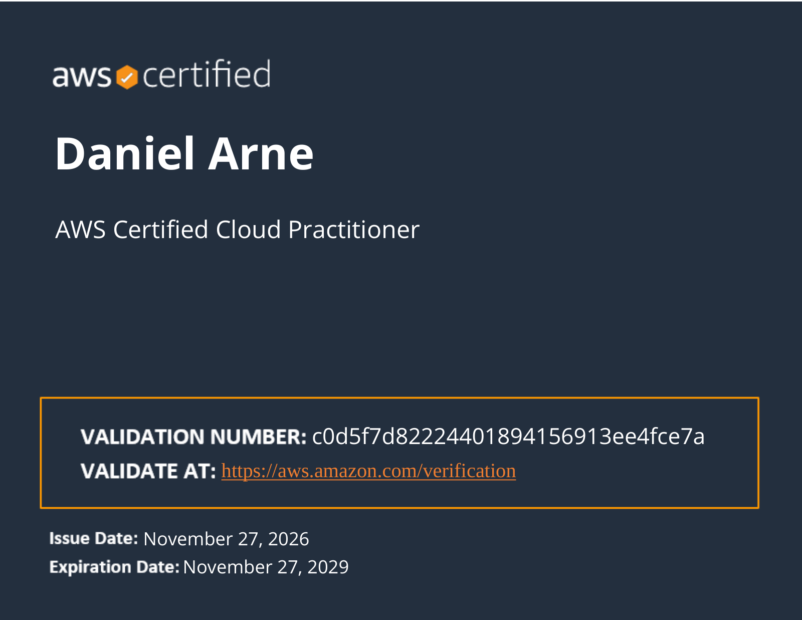

# AWS Certified Cloud Practitioner (CLF-C02)

The broad AWS foundation, studied alongside my fifth semester — part of my [AI Journey](../../README.md).

<!-- STATUS:START -->
🟢 &nbsp;Passed on 27 November 2026 — AWS Certified Cloud Practitioner
<!-- STATUS:END -->

---

###  &nbsp;The goal

Earn the AWS Certified Cloud Practitioner certification: compute, storage, networking, security and billing, the ground the AI Practitioner stood on. I fitted it in next to my studies. The exam attempt was valid until **30 November 2026**; I booked it for **27 November 2026** and passed.

###  &nbsp;Where this stands

<!-- STATE:START -->
**Completed 2026-11-27** — passed the CLF-C02, in German, at a test centre 
**About 50 hours over six weeks** — 368 cards across 4 domains, then the practice tests 
**A certification valid until November 2029** — the thing that outlasts the deck
<!-- STATE:END -->

###  &nbsp;The road, and how I studied

One deck per exam domain, in the guide's own order.

| | Domain | Share of the exam | Cards | Status |
|:---:|:---|:---:|:---:|:---:|
| 1 | Cloud Concepts | 24 % | 70 | ✅ |
| 2 | Security and Compliance | 30 % | 92 | ✅ |
| 3 | Cloud Technology and Services | 34 % | 149 | ✅ |
| 4 | Billing, Pricing, and Support | 12 % | 57 | ✅ |

Target dates per domain are in the [study plan](./study-plan.md).

**Cards instead of courses.** The semester does not leave me the hours to click through a thirteen-hour course. So the material went the other way round: the official course and the four domain reviews were condensed, with AI help, into one Anki deck, and the deck is what I study.

**Checked against the exam guide, not against the course.** Every task statement and every in-scope service in the guide has at least one card. The AI Practitioner taught me why: its practice tests asked about things no course in the learning plan covered.

**One thing per card, the question on the front.** The answer fits in a line or two; anything longer sits underneath in grey, for when I need it. 
**New cards and repeats every study day.** About fourteen new cards was the plan; in the last week of new material it was closer to twenty-three. 
**Short, fixed intervals.** *Again* comes back within minutes, *Hard* tomorrow, *Good* in two days, *Easy* in three. Nothing drifts out of sight for weeks. 
**A practice set right after each domain.** Every miss went back into the deck before the next domain started. 
**The last days were only testing.** The practice sets once more, two full practice exams, and a small deck made only of what those got wrong.

Five cards like the ones in the deck, written fresh for this page:

| Front | Back |
|:---|:---|
| Who patches the guest operating system on an EC2 instance? | **The customer.** AWS patches the host and the hypervisor underneath it. |
| Which service records who made which API call in an account? | **AWS CloudTrail.** CloudWatch watches metrics and logs; AWS Config records how resources are configured. |
| What can a service control policy in AWS Organizations do? | **Set the maximum permissions of an account.** It can forbid, it never grants anything; that stays with IAM. |
| A company wants to store database credentials and rotate them automatically. Which service? | **AWS Secrets Manager.** |
| A workload runs steadily all year. Which purchase option is cheapest? | **Reserved Instances or a Savings Plan,** committed for one or three years. |

**The deck itself stays private.** It is German and built from AWS training material, so it is not published here. This page carries the counts, the method and the topics instead.

###  &nbsp;The certificate

**Issued 27 November 2026** — the day of the exam; it expires on 27 November 2029 
**Validation number c0d5f7d82224401894156913ee4fce7a** — printed on the certificate itself, so it can be checked without this page linking anywhere 
**The certificate is English, the exam was not** — I sat it in German

###  &nbsp;The files here

[`progress.md`](./progress.md) — dated entries: how many cards, and which topics came up 
[`study-plan.md`](./study-plan.md) — what the deck covers, and the date it runs towards 
[`certificate.png`](./certificate.png) — the certificate, shown above
