# Progress Log

A running log of my AWS Cloud Practitioner journey. Newest entries at the top.

Working toward the **AWS Certified Cloud Practitioner (CLF-C02)**, studied from one Anki deck alongside my fifth semester. The exam attempt is valid until **30 November 2026**.

---

## 2026-10-16 (Fri) — Started: a deck instead of a course

- **Opened the Cloud Practitioner** as the next project after the AI Practitioner. It is the broad AWS foundation the AI exam assumed I had, and I am fitting it in next to my studies.
- **Built a 372-card Anki deck with AI help** from the official prep material: all thirteen modules of Cloud Practitioner Essentials and the four domain reviews, including their worked practice questions. One deck per exam domain, every card tagged with its task statement.
- **Checked against the exam guide, not against the course.** Every task statement and every in-scope service has at least one card. On the AI Practitioner the practice tests asked about things no course covered, so this time the guide came first.
- **The official practice questions are untouched,** so that whenever I sit them, the result measures what I know rather than what I have already seen.

**Next up:** the first reviews, domain 1, Cloud Concepts.
