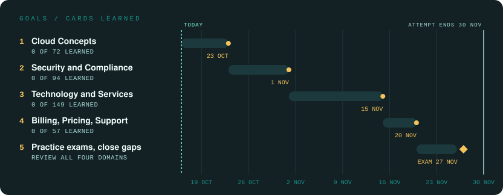

# Study Plan — AWS Certified Cloud Practitioner (CLF-C02)

The exam attempt is valid until **30 November 2026**. The plan runs towards that date, next to a full semester, so it is built around something I can do in short sessions rather than long ones.

---

###  &nbsp;What the deck is made of

**Cloud Practitioner Essentials**, all thirteen modules, from the introduction to the cloud to well-architected solutions. 
**The four domain reviews**, one per exam domain, with the worked practice questions that come with them. 
**The exam guide**, as the checklist: the deck is sorted by its nineteen task statements, and each card names the one it belongs to.

###  &nbsp;The goals

**Domain 1, Cloud Concepts** — 23 October 
**Domain 2, Security and Compliance** — 1 November 
**Domain 3, Technology and Services** — 15 November 
**Domain 4, Billing, Pricing, and Support** — 20 November 
\* **AWS Discovery Day** — 20 November, 13:30 to 16:30: an afternoon of Cloud Practitioner Essentials, live and virtual with an AWS training partner. One walk through the whole course a week before the exam 
**Practice exams** — 21 to 26 November: the official practice questions, every gap they show goes back into the cards, and all four domains get reviewed once more 
**The exam** — 27 November, three days before the attempt runs out

About ten new cards a day keeps the four domain dates. The bars fill as cards turn green, which in Anki means they have made it into the review pile. The practice exams come last on purpose: they measure what has stuck, so they only mean something once every card has been seen.

###  &nbsp;What is deliberately not in here

**No second pass through the videos.** The deck is the condensed version of them. 
**No published deck.** It is built from AWS training material and stays private. 
**No hour target.** Cards studied and topics covered are the measure. Since 21 October the time per day is noted in the [progress log](./progress.md), to see the total effort, not to hit a number.
